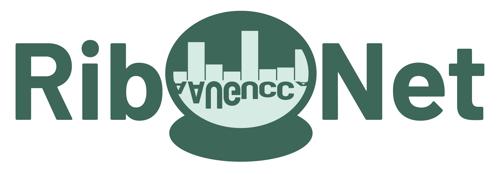

<p align="center">
	
</p>

# RiboNet

[](https://ribonet.readthedocs.io/en/latest/?badge=latest)
[](https://pypi.org/project/ribonet/)
[](https://anaconda.org/bioconda/ribonet)
[](LICENSE)

### Deep learning analysis toolkit for ribosome profiling.

This package is an automated analysis pipeline for the quantification, prediction, and interpretation of ribosome occupancy from ribosome profiling data. Given ribosome profiling data (BAM files) and RNA expression data, this pipeline will:

- Estimate A-site offsets using [RiboA](https://github.com/obrien-lab/aip_web_docker)
- Extract ribosome density profiles at codon or nucleotide resolution
- Train deep neural network models to predict ribosome counts and distribution along transcripts
- Leverage pre-trained language models ([RiNALMo](https://github.com/lbcb-sci/RiNALMo), [SpeciesLM](https://github.com/gagneurlab/SpeciesLM)) for sequence feature extraction
- Perform in silico mutagenesis to identify cis-regulatory sequences of ribosome occupancy
- Discover regulatory motifs using [TF-MoDISco](https://github.com/kundajelab/tfmodisco)
- Identify elongation patterns along coding sequences
- Generate comprehensive reports with visualizations

Full documentation: https://ribonet.readthedocs.io

> **⚠️ GPU Required:** RiboNet requires an NVIDIA GPU with CUDA support for training and inference. Running on CPU will lead to excessively long computation times.

## Installation

### Option 1: Bioconda (recommended)

Installs RiboNet with all its dependencies, including PyTorch with GPU support and the MEME suite (used to annotate discovered motifs):

```bash
conda create -n ribonet -c conda-forge -c bioconda ribonet
conda activate ribonet
```

Conda selects the CUDA build of PyTorch automatically when it detects an NVIDIA driver. If you install on a machine without GPU (e.g. a cluster login node) to run on GPU nodes, request it explicitly:

```bash
CONDA_OVERRIDE_CUDA=12.6 conda create -n ribonet -c conda-forge -c bioconda ribonet "pytorch=*=cuda*"
```

### Option 2: Pip

```bash
conda create -n ribonet python=3.11   # or any other virtual environment
conda activate ribonet
pip install ribonet
```

On Linux, the PyTorch wheels installed by pip include CUDA support. Motif annotation in `ribonet report` additionally requires `tomtom` from the MEME suite, which is not available on PyPI: install it with `conda install -c conda-forge -c bioconda meme` (otherwise motifs are discovered but not annotated).

### Option 3: Development installation

```bash
git clone https://github.com/nedialkova-lab/RiboNet
cd RiboNet
conda create -n ribonet -c conda-forge -c bioconda python=3.11 meme
conda activate ribonet
pip install -e ".[test]"
```

### Optional components

- RiNALMo language model (`--lm rinalmo`): `pip install "ribonet[rinalmo]"` (or `pip install multimolecule`).
- Pre-trained language models are downloaded automatically on first use.

Verify the installation and GPU detection:

```bash
ribonet --version
python -c "import torch; print('CUDA available:', torch.cuda.is_available())"
```

## Test your installation

The [`tests`](tests) folder contains a small synthetic dataset that runs the complete pipeline: 2 conditions (WT and KD) with 2 replicates each, short (20-23 nt) and long (27-32 nt) ribosome footprints, on 561 genes of yeast chromosomes II and III. The ribosome footprints and RNA counts are simulated (see [`tests/generate_test_data.py`](tests/generate_test_data.py)); the KD condition has slower decoding of AAA, CAA and GAA codons, which the trained model recovers (higher predicted A-site occupancy of AAA and CAA in KD, see the codon occupancy plot of `training/training.pdf`).

On a GPU node (~1 h on an NVIDIA A40):

```bash
git clone https://github.com/nedialkova-lab/RiboNet
bash RiboNet/tests/run_test.sh my_test_output 8   # output folder, number of threads
```

The test ends with `TEST PASSED` and produces the QC (`riboA/QC_report.pdf`), training (`training/training.pdf`) and interpretation (`interpretation/interpretation.pdf`) reports. The files in [`tests/data`](tests/data) also illustrate the expected format of every input: sample sheet, RNA counts, genome FASTA, GFF3 annotation and BAM files.

Quick checks of the installation (CPU, ~1 min) can be run with `pytest RiboNet/tests` (requires `pip install pytest`).

## Usage

RiboNet analysis consists of three main steps: preprocessing, training, and interpretation.

### 1. Preprocess

Preprocess ribosome profiling data and prepare it for training:

```bash
ribonet preprocess \
  --sample_file samples.txt \
  --rna_counts rna_counts.txt \
  --genome_fasta genome.fa \
  --gff annotation.gff \
  --project_dir my_project \
  --threads 8
```

The `samples.txt` file should be tab-separated with columns: `sample_id`, `condition`, `readlength`, `bam`. The RNA counts file is tab-separated with the gene identifier, a `Length` column and one column of counts per condition. See [`tests/data`](tests/data) and the [input documentation](https://ribonet.readthedocs.io/en/latest/inputs.html) for examples.

### 2. Train

Train a RiboNet model to predict ribosome occupancy:

```bash
ribonet train \
  --project_dir my_project \
  --resolution codon
```

For nucleotide-resolution models:

```bash
ribonet train \
  --project_dir my_project \
  --resolution nucleotide
```

### 3. Interpret

Perform in silico mutagenesis and motif discovery:

```bash
ribonet interpret \
  --project_dir my_project \
  --n_batches 10 \
  --scoring ISM
```

With `--n_batches 1`, all genes are scored directly. With more batches, a SLURM job array script (`ribonet_array.sbatch`) is written to the project directory, and each batch is scored separately (can be parallelized using SLURM or similar):

```bash
ribonet score_batch \
  --project_dir my_project \
  --batch n
```

Generate final report with motif analysis:

```bash
ribonet report \
  --project_dir my_project \
  --control WT \
  --threads 8
```

## Contact

Please log all issues/suggestions on the RiboNet GitHub page: https://github.com/nedialkova-lab/RiboNet/issues

Xavier Hernandez-Alias: [xhernandez@ub.edu](mailto:xhernandez@ub.edu)

https://compreggen.github.io

Danny Nedialkova: [danny.nedialkova@maxperutzlabs.ac.at](mailto:danny.nedialkova@maxperutzlabs.ac.at)

https://www.biochem.mpg.de/nedialkova

Julien Gagneur: [gagneur@in.tum.de](mailto:gagneur@in.tum.de)

https://www.cs.cit.tum.de/cmm/home/

## Cite

If you use RiboNet in your research, please cite:

*Manuscript in preparation*

## License

The source code of RiboNet is under the [MIT license](LICENSE). The source code of RiboA is under the [MIT license](https://github.com/obrien-lab/aip_web_docker). The source code of TF-MoDISco is under the [MIT license](https://github.com/kundajelab/tfmodisco). The source code and model parameters of the DNA language model SpeciesLM is under the [MIT license](https://github.com/gagneurlab/SpeciesLM). The source code of the RNA language model RiNALMo is licensed under the [Apache License, Version 2.0](https://github.com/lbcb-sci/RiNALMo). The RiNALMo pretrained model parameters are made available under the terms of the [Creative Commons Attribution 4.0 International (CC BY 4.0) license](https://creativecommons.org/licenses/by/4.0/legalcode).
